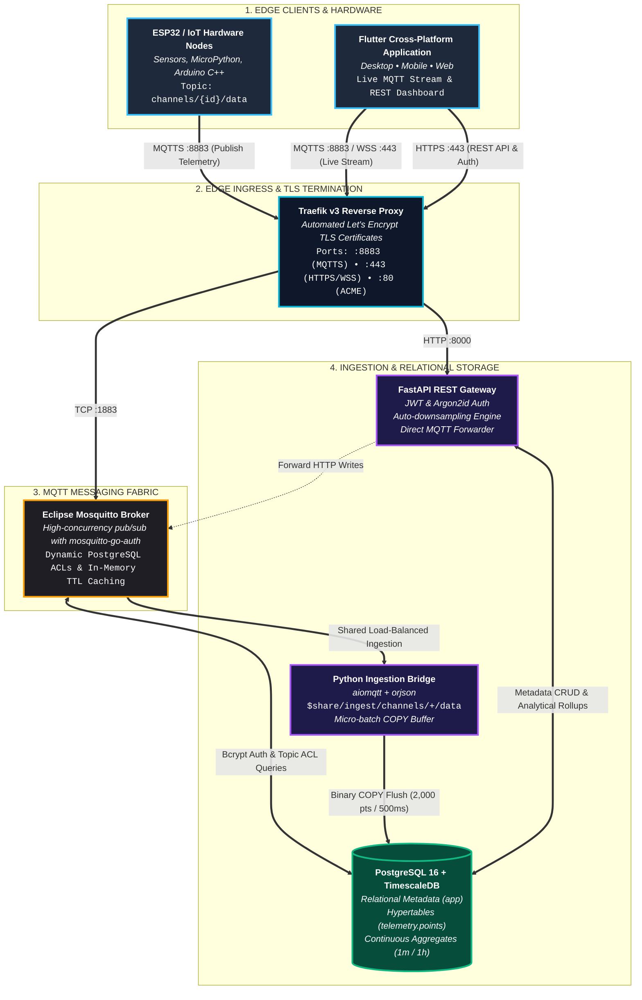

# ThingLarp IoT Platform

[](https://thinglarp.iimarky123.io.vn)
[](https://github.com/iimarky1234/thinglarp)
[](docker-compose.yml)
[](api/)
[](db/)
[](app/)

**ThingLarp** is a high-performance, completely unconstrained IoT telemetry and analytics platform built as an open-source, modern alternative to ThingSpeak.

> 📖 **Full Documentation & Guides:** [https://thinglarp.iimarky123.io.vn](https://thinglarp.iimarky123.io.vn)
>
> ⚡ **Disclaimer:** This project was mostly **vibe coded** by **Antigravity** (Google DeepMind's agentic AI assistant) in collaboration with **@iimarky123**. While built with production-grade architectural patterns, microservices, and end-to-end test verification, make sure to review configurations and security secrets before deploying to critical production environments!

---

## 🌟 Key Highlights

- **Zero Artificial Rate Limits:** High-frequency sensors (vibration, acoustics, motor RPM) can stream telemetry continuously at 50Hz–100Hz without being throttled to legacy 15-second windows.
- **Unlimited Dynamic Fields:** No restriction to fixed `field1`...`field8` slots. Devices publish arbitrary JSON payloads (`{"temp": 24.2, "co2_ppm": 420, "gyro_z": -0.012}`). Fields are dynamically discovered, indexed, and charted on the fly.
- **Strict Multi-Tenant ACLs:** Broker-level security powered by `mosquitto-go-auth` and PostgreSQL views. Devices can only publish to their assigned channel; dashboards can only subscribe to owned or public channels.
- **TimescaleDB Continuous Aggregates:** Ingests raw points into compressed hypertables with background 1-minute (`telemetry.points_1m`) and 1-hour (`telemetry.points_1h`) rollups for millisecond chart rendering across millions of rows.
- **Dual-Ingress Parity:** HTTP REST writes (`POST /channels/{id}/data`) publish directly to the internal MQTT broker so live subscribers see updates instantly.
- **Cross-Platform Flutter Dashboard:** Native client for Linux Desktop, macOS, Windows, Android, iOS, and Web featuring real-time MQTT streaming, dynamic metric badges, and interactive time-series charts.

---

## 🏗 Architecture Overview



---

## 🗂 Repository Structure

```text
.
├── docker-compose.yml        # Multi-container orchestration (5 microservices)
├── .env.example              # Centralized environment configuration template
├── api/                      # FastAPI Gateway (Auth, Channels, Devices, Keys, Data)
├── bridge/                   # High-throughput asynchronous Python Ingestion Bridge
├── mosquitto/                # Mosquitto config with mosquitto-go-auth plugin & caching
├── traefik/                  # Traefik v3 reverse proxy & automated Let's Encrypt TLS
├── db/                       # PostgreSQL & TimescaleDB initialization scripts (01-03)
├── app/                      # Cross-platform Flutter client (Mobile/Desktop/Web)
├── docs/                     # Comprehensive MkDocs documentation source
├── mkdocs.yml                # MkDocs Material theme & site configuration
└── scripts/                  # Automated E2E verification & live waveform generators
```

---

## 🚀 Quickstart

### 1. Clone & Configure Environment
```bash
git clone https://github.com/iimarky1234/thinglarp.git
cd thinglarp
cp .env.example .env
chmod 600 .env
# Edit .env with your domain names and database credentials
```
> For a full explanation of every configuration setting, see the [Environment Configuration Guide](https://thinglarp.iimarky123.io.vn/guides/env_configuration/).

### 2. Start the Backend Infrastructure
```bash
docker compose up -d --build
```

Verify that all 5 containers are running:
```bash
docker compose ps
```

### 3. Launch the Flutter Application
```bash
cd app/
flutter run -d linux
```
*Default Administrator Credentials:*
- **Username:** `admin`
- **Password:** `admin123456`
*(You can also register any new account directly from the app screen).*

### 4. Run Live Waveform Streamer (Optional)
To animate real-time charts in the Flutter app without physical hardware:
```bash
./scripts/stream_generator.py --channel 1 --key <YOUR_WRITE_API_KEY> --interval 1.5
```

---

## 📚 Complete Documentation

All architectural designs, hardware provisioning examples, API references, and security models are published at:

👉 **[https://thinglarp.iimarky123.io.vn](https://thinglarp.iimarky123.io.vn)**

- **[System Architecture](https://thinglarp.iimarky123.io.vn/architecture/overview/)**
- **[Interactive Block Diagrams](https://thinglarp.iimarky123.io.vn/architecture/block_diagrams/)**
- **[Database & TimescaleDB Hypertables](https://thinglarp.iimarky123.io.vn/architecture/database/)**
- **[Hardware Provisioning (ESP32, MicroPython, Python)](https://thinglarp.iimarky123.io.vn/guides/hardware_provisioning/)**
- **[REST API Reference](https://thinglarp.iimarky123.io.vn/reference/api_reference/)**
- **[MQTT Topics & Permissions](https://thinglarp.iimarky123.io.vn/reference/mqtt_topics/)**
- **[Environment Variables Reference](https://thinglarp.iimarky123.io.vn/reference/environment_variables/)**

---

## 📄 License
This project is licensed under the MIT License.
