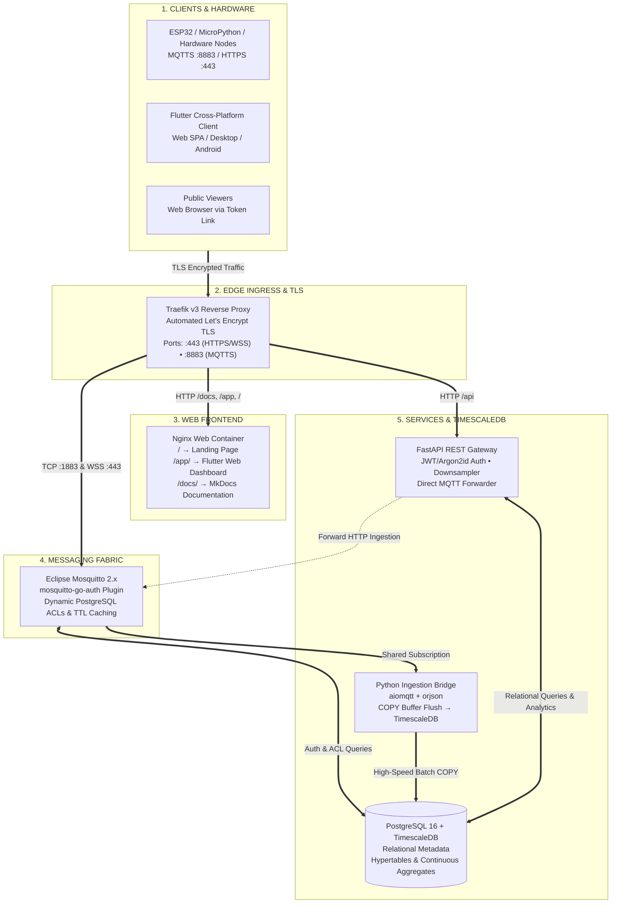

# ThingLarp IoT Platform

[](https://thinglarp.iimarky123.io.vn/app/)
[](https://thinglarp.iimarky123.io.vn/docs/)
[](https://api.iimarky123.io.vn/docs)
[](https://github.com/iimarky1234/thinglarp)
[](docker-compose.yml)
[](db/)
[](app/)

**ThingLarp** is a high-performance, completely unconstrained IoT telemetry and analytics platform built as an open-source, modern alternative to ThingSpeak.

> 🌐 **Live Web Application:** [https://thinglarp.iimarky123.io.vn/app/](https://thinglarp.iimarky123.io.vn/app/)  
> 📖 **User Documentation:** [https://thinglarp.iimarky123.io.vn/docs/](https://thinglarp.iimarky123.io.vn/docs/)  
> 📦 **Client App Releases:** [https://github.com/iimarky1234/thinglarp/releases](https://github.com/iimarky1234/thinglarp/releases)  
>
> ⚡ **Disclaimer:** This project was mostly **vibe coded** by **Antigravity** (Google DeepMind's agentic AI assistant) in collaboration with **@iimarky123**. Built with production-grade architectural patterns, microservices, and end-to-end test verification.

---

## 🌐 Public Endpoints

| Service | Public Endpoint | Description |
| :--- | :--- | :--- |
| **Landing & Downloads** | [`https://thinglarp.iimarky123.io.vn/`](https://thinglarp.iimarky123.io.vn/) | Platform overview & client app downloads |
| **Web Dashboard** | [`https://thinglarp.iimarky123.io.vn/app/`](https://thinglarp.iimarky123.io.vn/app/) | Official Web SPA dashboard & public channel viewer |
| **User Documentation** | [`https://thinglarp.iimarky123.io.vn/docs/`](https://thinglarp.iimarky123.io.vn/docs/) | Comprehensive MkDocs usage & hardware guides |
| **REST API Gateway** | [`https://api.iimarky123.io.vn`](https://api.iimarky123.io.vn) | Ingestion & management REST API (Swagger at `/docs`) |
| **MQTT Broker (TCP TLS)** | `mqtt.iimarky123.io.vn:8883` | Direct MQTTS for ESP32, microcontrollers & native apps |
| **MQTT Broker (WebSockets)** | `wss://mqtt.iimarky123.io.vn/mqtt` | Secure WebSockets (port 443) for browser dashboards |

---

## 🌟 Key Highlights

- **Zero Artificial Rate Limits:** Stream telemetry at 50Hz–100Hz without artificial 15-second wait times.
- **Unlimited Dynamic Fields:** No arbitrary limit to 8 predefined fields. Publish any valid JSON payload (`{"temp": 24.2, "humidity": 60, "vibration_x": 0.05}`) and fields are discovered and graphed dynamically.
- **1-Click Public Channel Sharing:** Generate unique, secure tokenized links (`/app/?public_token=...`) to share live telemetry and charts with clients or teammates without requiring an account.
- **High-Performance TimescaleDB Engine:** Telemetry is written directly to TimescaleDB hypertables with automated continuous aggregates (`points_1m`, `points_1h`) for real-time downsampling across millions of points.
- **Bi-Directional Telemetry & Downlinks:** Ingest sensor data and send commands down to microcontrollers and relays (`channels/{id}/commands`).
- **Dual-Ingress Parity:** Send data over HTTP REST (`POST /channels/{id}/data`) or MQTT (`channels/{id}/messages`) seamlessly with real-time broker synchronization.
- **Cross-Platform Client Suite:** Responsive Flutter client running natively in the browser (Web SPA/PWA) and on Android, Linux, Windows, macOS, and iOS.

---

## 🏗 Architecture Overview



---

## 🗂 Repository Structure

```text
.
├── docker-compose.yml        # Orchestration for all 6 microservices
├── .env.example              # Centralized environment template
├── api/                      # FastAPI REST Gateway (Auth, Channels, Data, Public Links)
├── app/                      # Flutter multiplatform client (Web, Android, Desktop)
├── bridge/                   # Asynchronous Python MQTT Ingestion Bridge (aiomqtt + asyncpg)
├── db/                       # Database initialization schemas, hypertables & migrations
├── docs/                     # User-focused MkDocs documentation source
├── mkdocs.yml                # Material theme documentation configuration
├── mosquitto/                # Mosquitto config with dynamic PostgreSQL ACL plugin
├── scripts/                  # Synthetic waveform generators & test suites
├── traefik/                  # Traefik v3 reverse proxy config & TLS rules
└── web/                      # Nginx frontend hosting landing page, /app/, and /docs/
```

---

## 🚀 Quickstart

### 1. Clone & Configure Environment
```bash
git clone https://github.com/iimarky1234/thinglarp.git
cd thinglarp
cp .env.example .env
chmod 600 .env
# Edit .env with your domain names and database credentials
```

### 2. Launch the Stack
```bash
docker compose up -d --build
```

Verify that all 6 containers are healthy:
```bash
docker compose ps
```

### 3. Access the Dashboard
- **Web App:** Open [https://thinglarp.iimarky123.io.vn/app/](https://thinglarp.iimarky123.io.vn/app/) (or `http://localhost/app/` if running locally).
- **Default Admin Account:**
  - **Username:** `admin`
  - **Password:** `admin123456`
  *(You can also register any new account directly from the login screen).*

### 4. Send Test Telemetry

#### Via HTTP REST (cURL):
```bash
curl -X POST "https://api.iimarky123.io.vn/channels/1/data" \
  -H "X-API-Key: YOUR_WRITE_API_KEY" \
  -H "Content-Type: application/json" \
  -d '{"temperature": 24.5, "humidity": 58.2, "co2": 415}'
```

#### Via Synthetic Stream Generator (Python):
```bash
./scripts/stream_generator.py --channel 1 --key YOUR_WRITE_API_KEY --interval 1.0
```

---

## 📚 Documentation & Integration Guides

Complete step-by-step guides, code snippets, and API specifications are published at:

👉 **[https://thinglarp.iimarky123.io.vn/docs/](https://thinglarp.iimarky123.io.vn/docs/)**

- **[Getting Started & Dynamic Fields](https://thinglarp.iimarky123.io.vn/docs/getting_started/)**
- **[Dashboard Tuning & Widgets](https://thinglarp.iimarky123.io.vn/docs/dashboard/)**
- **[1-Click Public Link Sharing](https://thinglarp.iimarky123.io.vn/docs/public_sharing/)**
- **[Sending Data via HTTP](https://thinglarp.iimarky123.io.vn/docs/sending_data_http/)**
- **[Sending Data via MQTT](https://thinglarp.iimarky123.io.vn/docs/sending_data_mqtt/)**
- **[ESP32 & ESP8266 Arduino Guide](https://thinglarp.iimarky123.io.vn/docs/hardware/esp32/)**
- **[MicroPython Integration (ESP32 / Pico W)](https://thinglarp.iimarky123.io.vn/docs/hardware/micropython/)**
- **[Python Edge Gateway Guide](https://thinglarp.iimarky123.io.vn/docs/hardware/python/)**
- **[Downlink Actuator Commands](https://thinglarp.iimarky123.io.vn/docs/hardware/commands/)**
- **[REST API Reference](https://thinglarp.iimarky123.io.vn/docs/reference/api_reference/)**
- **[MQTT Topics & ACL Rules](https://thinglarp.iimarky123.io.vn/docs/reference/mqtt_topics/)**

---

## 📄 License
This project is licensed under the MIT License.
