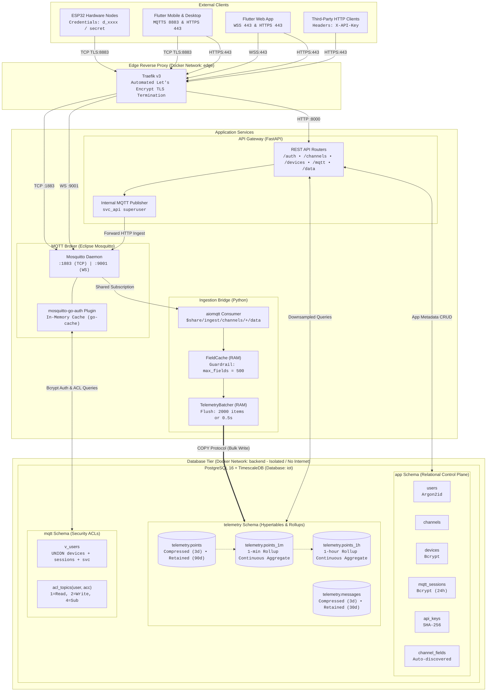
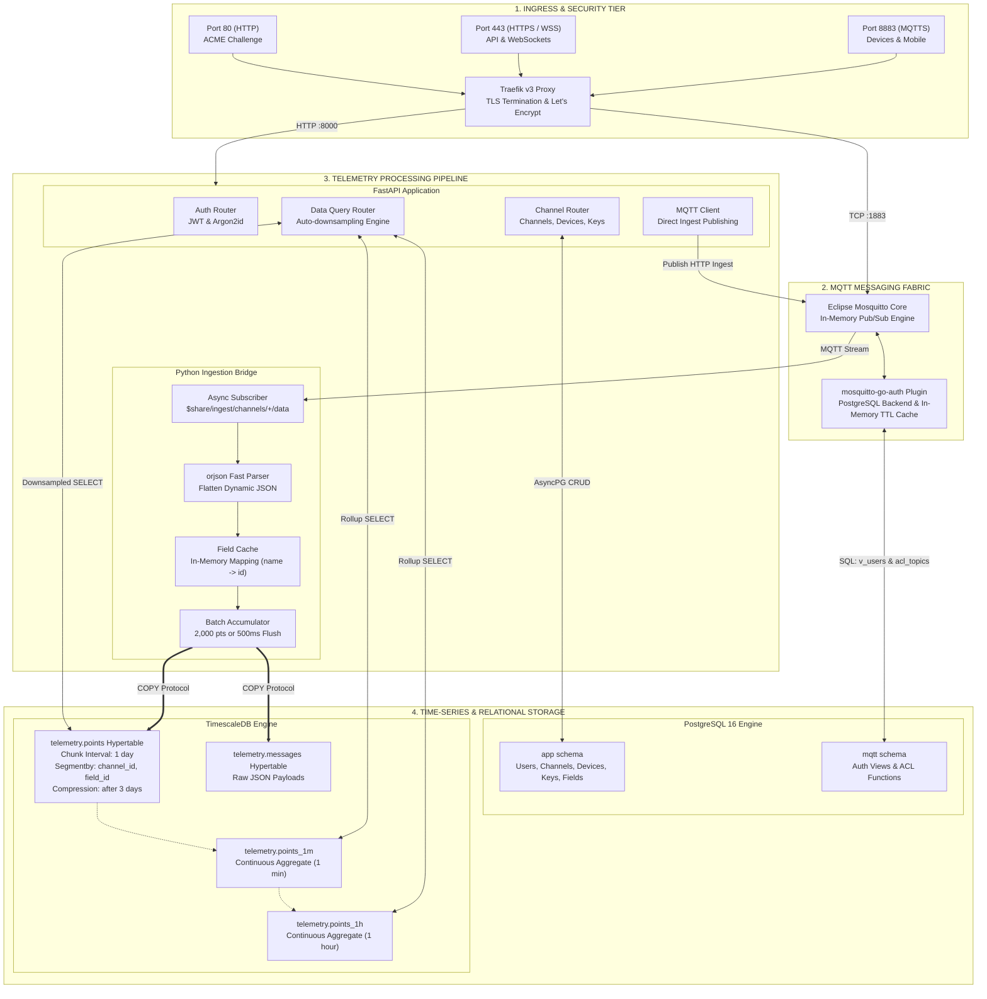
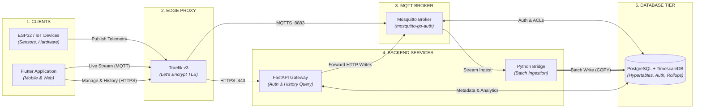

# System Block Diagrams

This page contains detailed architectural block diagrams illustrating the data path, network segmentation, and service responsibilities of the ThingLarp platform.

---

## 1. High-Level Architecture Flow

---

## 2. Component Responsibility Diagram

---

## 3. Simple Overview Diagram

