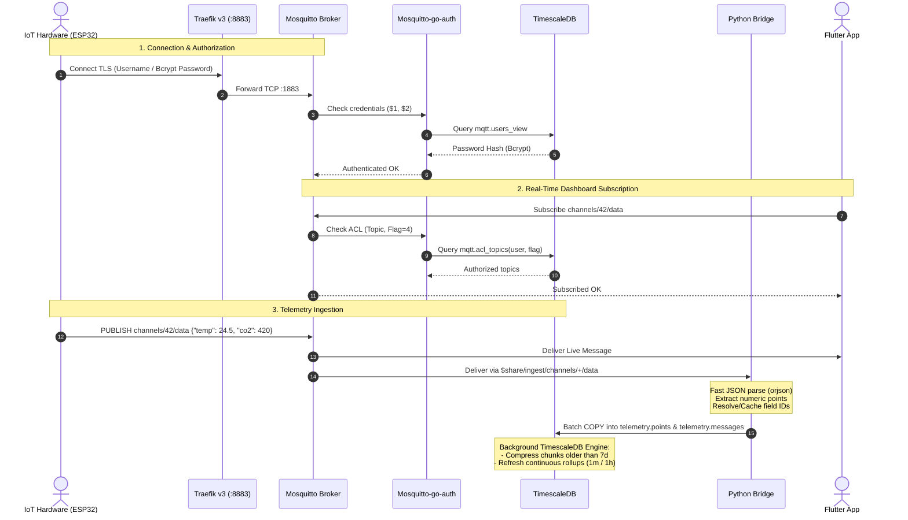

# System Architecture & Ingestion Pipeline

ThingLarp is designed as a decoupled, asynchronous microservices architecture that separates the high-frequency telemetry ingestion path from the relational metadata and analytical query path.

---

## Architectural Principles

1. **Decoupled Ingestion Pipeline:** Devices publish telemetry to MQTT topics (`channels/{id}/data`). Neither the API nor the device communicates directly with the database. The Python Ingestion Bridge acts as a dedicated worker group consuming via shared MQTT subscriptions.
2. **Strict Least-Privilege Authorization:** Database access is segregated across dedicated PostgreSQL roles (`iot_mqtt_auth`, `iot_bridge`, `iot_api`) preventing any service from reading or mutating tables outside its operational scope.
3. **Optimized Time-Series Storage:** Raw sensor readings are normalized into narrow rows (`time`, `channel_id`, `field_id`, `value`) within TimescaleDB hypertables, combined with chunk compression and background continuous aggregate materialization.
4. **Dual-Ingress Parity:** HTTP REST writes (`POST /channels/{id}/data`) forward the payload directly to the internal MQTT broker. Live subscribers (such as Flutter dashboards) observe real-time events identically whether the source is MQTT or HTTP.

---

## End-to-End Ingestion Flow

---

## Microservices Breakdown

### 1. Edge Proxy (Traefik v3)
- Handles inbound network traffic from public networks.
- Manages automatic Let's Encrypt TLS termination for both HTTP (`:80`, `:443`) and secure MQTT (`:8883`).
- Provides reverse proxying to the internal Docker bridge network (`edge` and `backend`).

### 2. MQTT Broker (Eclipse Mosquitto + mosquitto-go-auth)
- Handles persistent connections from thousands of IoT devices and Flutter applications.
- Dynamically queries PostgreSQL views for authentication and topic authorization checks on every connect, publish, and subscribe attempt.
- Supports MQTT over WebSockets (`:9001`) for Flutter Web.

### 3. Ingestion Bridge (`bridge/`)
- Pure asynchronous Python daemon (`aiomqtt` + `asyncpg`).
- Connects using shared subscriptions: `$share/ingest/channels/+/data`, allowing horizontal scaling across multiple container replicas without message duplication.
- Micro-batches incoming messages and writes in bulk to TimescaleDB using PostgreSQL binary `COPY` protocol.

### 4. REST & Metadata API (`api/`)
- High-performance FastAPI application.
- Exposes user registration, JWT generation, channel provisioning, device token generation, and API key management.
- Provides optimized telemetry querying with automatic resolution downsampling (`auto`, `1m`, `1h`, `raw`).

### 5. Time-Series Database (TimescaleDB / PostgreSQL 16)
- Stores platform relational metadata (`app` schema), time-series hypertables (`telemetry` schema), and broker auth views (`mqtt` schema).
- Automatically rolls up raw points into 1-minute and 1-hour pre-computed continuous aggregate views.
