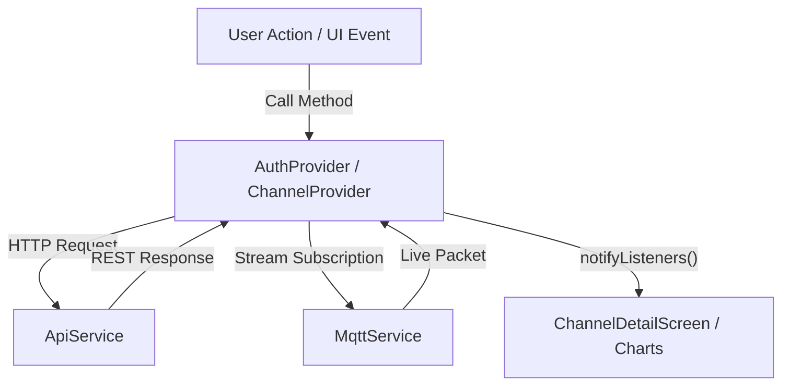

# Flutter Client Application

The **ThingLarp App** (`app/`) is a cross-platform client developed with Flutter 3.x that runs on **Linux Desktop**, **macOS**, **Windows**, **Android**, **iOS**, and **Web**.

---

## Key Features

- **Dynamic Endpoints:** Configure custom API endpoints and MQTT broker addresses on the fly with persistent local storage (`SharedPreferences`).
- **Interactive Time-Series Visualizations:** Line charts powered by `fl_chart` with touch tooltips, dynamic multi-field coloring, and time-axis formatting.
- **Multi-Type Dashboard Widgets:** Customize each field's visualization on the fly between **Line Chart** (time-series curve), **Radial Gauge** (270° gradient arc with min/max bounds), **KPI Metric Card** (bold hero readout with min/avg/max stats), and **Status / LED Indicator** (glowing active/inactive status beacon). Selections persist in TimescaleDB.
- **Dynamic Field Auto-Discovery:** Badges and metric cards dynamically spawn as incoming JSON packets reveal new keys.
- **Real-Time MQTT Streaming:** Direct subscription to live channel topics (`channels/{id}/data`) using ephemeral session tokens.
- **Resolution Selector:** Toggle between **Auto**, **Raw**, **1-Minute**, and **1-Hour** historical aggregations.
- **Hardware & Device Access Control:** Provision hardware credentials with granular permission scopes (`Publish Only`, `Subscribe Only`, or `Full Pub/Sub`) and an instant Active/Suspended toggle.
- **Downlink Remote Control & Commands:** Send downstream actuator commands and control JSON packets to subscribed IoT nodes (`channels/{id}/commands`) with quick action presets (`Relay ON/OFF`, `Reboot`, `LED Toggle`).
- **Data Export & Download:** Export telemetry directly to CSV spreadsheets or JSON arrays with customizable time windows and resolution aggregations.
- **Data Import & Migration Tool:** Import historical data from ThingSpeak CSV files or standard CSV formats with automatic column and field discovery.
- **Data Purge / Clear:** Safely clear historical telemetry and message logs with confirmation safeguards while keeping field schemas intact.
- **In-App API Tutorial & Interactive Code Generator:** View pre-filled cURL, Python, JS, and ESP32 code snippets with your active channel ID and API key, plus a live ping tester.
- **Admin User Management Console:** Platform administrators can search users, toggle account status, promote/demote admins, reset passwords, and inspect cluster metrics.

---

## Application Structure

```
app/lib/
├── config.dart                     # AppConfig: API & MQTT endpoint persistence
├── models/
│   ├── user.dart                   # AuthToken & User profile models
│   ├── channel.dart                # Channel, Device, & ApiKey models
│   └── telemetry.dart              # TelemetryPoint, TimeSeries, & TelemetryMessage
├── services/
│   ├── api_service.dart            # HTTP client managing JWT headers & requests
│   └── mqtt_service.dart           # MQTT stream consumer subscribing to live channels
├── providers/
│   ├── auth_provider.dart          # Session state, login, register, logout
│   └── channel_provider.dart       # Channel list, telemetry history, & live updates
├── views/
│   ├── settings_screen.dart        # Host / Port / API endpoint configuration
│   ├── login_screen.dart           # Sign In & Registration forms
│   ├── channels_screen.dart        # Channel list cards & channel creation modal
│   ├── channel_detail_screen.dart  # Channel dashboard: Charts, Messages, Devices, Keys
│   ├── admin_users_screen.dart     # Admin dashboard: Metrics, user moderation, credentials
│   └── api_tutorial_screen.dart    # Interactive API tutorials & live telemetry ping tester
└── main.dart                       # App initialization with Dark/Light theme
```

---

## Building and Running

### Prerequisites
- Flutter SDK 3.24+ (Dart 3.5+)
- Linux Desktop dependencies: `clang`, `cmake`, `ninja-build`, `pkg-config`, `libgtk-3-dev`.

### Running on Linux Desktop
```bash
cd app/
flutter run -d linux
```

### Running on Web
```bash
cd app/
flutter run -d chrome
```

### Compiling a Release Binary
=== "Linux Desktop"
    ```bash
    flutter build linux --release
    # Binary output: app/build/linux/x64/release/bundle/thinglarp_app
    ```

=== "Web Bundle"
    ```bash
    flutter build web --release
    # Static output: app/build/web/
    ```

=== "Android APK"
    ```bash
    flutter build apk --release
    ```

---

## State Management (`Provider`)

The application uses Flutter's `provider` architecture:



---

## Admin User Management Console

When authenticated with an administrator account (`is_admin: true`), an **Admin Panel** icon button appears in the main channels AppBar.

### Capabilities:
- **System Metrics:** Live overview of platform totals (Registered Users, Active Accounts, Platform Administrators).
- **Search & Filter:** Instant real-time username and email filtering.
- **Account Moderation:**
  - One-click toggle between **Active** and **Suspended** states.
  - Role promotion or demotion (**Admin** badge).
  - Administrative **Password Reset** dialog without requiring the old password.
  - Safe account deletion with confirmation prompt.
