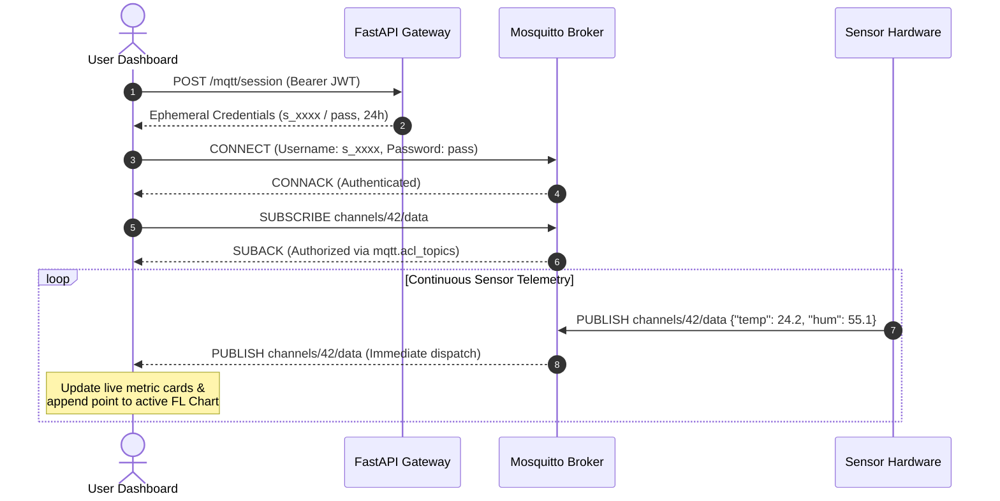

# Live MQTT Streaming & Real-Time Updates

A central feature of ThingLarp is immediate, real-time telemetry streaming directly to client dashboards over MQTT, eliminating polling overhead and latency.

---

## The Streaming Workflow



---

## Acquiring Ephemeral Frontend Credentials

To preserve security, end-users never connect using their primary account password. The client requests a dedicated, short-lived session token:

```http
POST /mqtt/session
Authorization: Bearer <USER_JWT_TOKEN>
```

**Response:**
```json
{
  "username": "s_a1b2c3d4e5f6...",
  "password": "generated_secure_password",
  "expires_at": "2026-11-13T12:00:00Z"
}
```

This username is stored in `app.mqtt_sessions` and automatically authorized by `mqtt.acl_topics()` to read and subscribe only to channels owned by the user or marked public.

---

## MQTT Client Implementation (`MqttService`)

In `app/lib/services/mqtt_service.dart`, the client manages the connection lifecycle:

```dart
class MqttService {
  final AppConfig config;
  MqttServerClient? _client;
  final StreamController<TelemetryMessage> _messageStream = StreamController.broadcast();

  Stream<TelemetryMessage> get messages => _messageStream.stream;

  Future<void> connect(String username, String password) async {
    _client = MqttServerClient(config.mqttHost, 'tl_app_${DateTime.now().millisecondsSinceEpoch}')
      ..port = config.mqttPort
      ..keepAlivePeriod = 30
      ..autoReconnect = true;

    final connMessage = MqttConnectMessage()
        .authenticateAs(username, password)
        .withWillTopic('clients/disconnect')
        .startClean();
    _client!.connectionMessage = connMessage;

    await _client!.connect();

    _client!.updates?.listen((List<MqttReceivedMessage<MqttMessage>> c) {
      final recMess = c[0].payload as MqttPublishMessage;
      final pt = MqttPublishPayload.bytesToStringAsString(recMess.payload.message);
      final json = jsonDecode(pt);
      
      _messageStream.add(TelemetryMessage(
        time: DateTime.now(),
        channelId: parseChannelId(c[0].topic),
        payload: json,
      ));
    });
  }

  void subscribeToChannel(int channelId) {
    _client?.subscribe('channels/$channelId/data', MqttQos.atMostOnce);
  }
}
```

---

## Auto-Reconnection & State Resilience

1. **Network Dropouts:** If the device loses internet access, the client activates an exponential backoff reconnection strategy.
2. **Session Expiry (24 hours):** When an ephemeral token expires, the client transparently calls `POST /mqtt/session` to obtain a fresh session credential and reconnects seamlessly.
