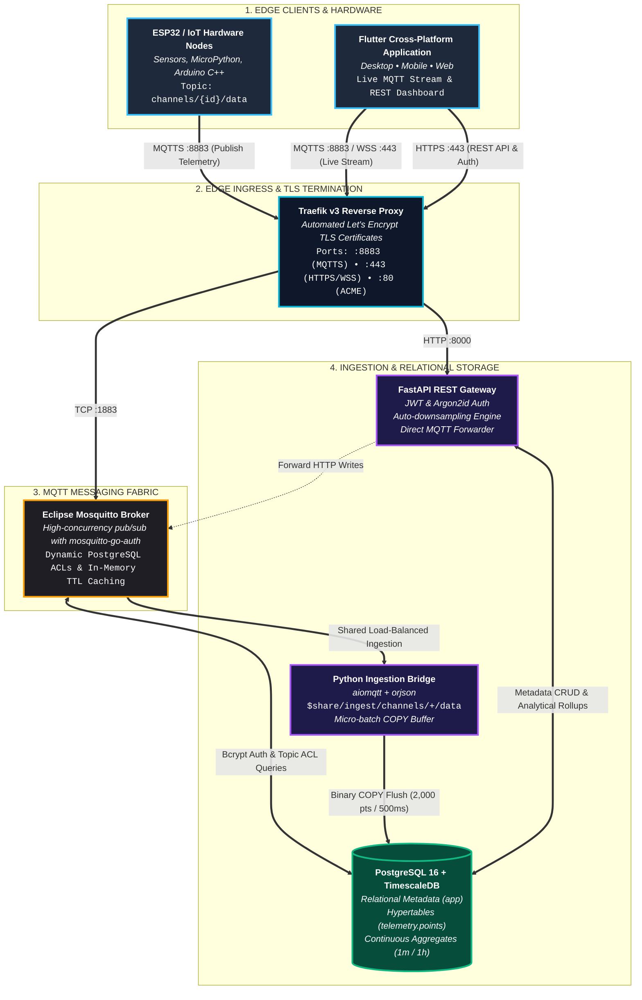

# ThingLarp IoT Platform

**ThingLarp** is a high-performance, completely unconstrained IoT telemetry and analytics platform built as an open, modern alternative to ThingSpeak. 

It provides native MQTT ingestion, dynamic field auto-discovery without prior schema definitions, microsecond time-series storage powered by TimescaleDB, and an cross-platform Flutter dashboard for desktop, mobile, and web.

!!! note "⚡ Vibe Coding Disclaimer"
    This project was mostly **vibe coded** by **Antigravity** (Google DeepMind's agentic AI assistant) in close collaboration with **@iimarky123**. While designed with production-grade architectural patterns, microservices, and end-to-end verification tests, please review all configurations and security secrets before deploying to critical production infrastructure.

---

## Key Capabilities

=== "🚀 No Rate Limits"
    Unlike legacy IoT platforms that throttle free tiers to 1 update every 15–60 seconds, ThingLarp enforces **zero artificial rate limits**. High-frequency sensors (vibration, acoustics, motor RPM) can stream at 50Hz–100Hz continuously.

=== "📈 Unlimited Dynamic Fields"
    No more restriction to 8 numeric fields (`field1`...`field8`). Devices can publish arbitrary JSON key-value pairs (e.g. `{"temp": 24.5, "co2_ppm": 420, "gyro_z": -0.012}`). Fields are dynamically discovered, indexed, and charted on the fly.

=== "🔒 Strict Multi-Tenant Security"
    Every MQTT publish and subscribe is strictly authorized at the broker level using `mosquitto-go-auth` and PostgreSQL views. Devices can only publish to their provisioned channel; client apps can only subscribe to channels they own or are public.

=== "⚡ TimescaleDB Continuous Aggregates"
    Raw sensor readings are ingested into compressed hypertables with background continuous aggregate views (`points_1m` and `points_1h`). Queries across months of data return in milliseconds.

=== "📱 Cross-Platform Flutter Dashboard"
    A native Flutter client for Linux Desktop, macOS, Windows, Android, iOS, and Web featuring real-time MQTT streaming, dynamic metric cards, and responsive time-series charts powered by `fl_chart`.

---

## System Architecture at a Glance

---

## Technology Stack

| Layer | Component | Description |
| :--- | :--- | :--- |
| **Edge Proxy** | [Traefik v3](services/traefik.md) | Reverse proxy terminating TLS, automated Let's Encrypt certificates, TCP/HTTP routing. |
| **MQTT Broker** | [Eclipse Mosquitto](services/mosquitto.md) | High-concurrency MQTT broker with `mosquitto-go-auth` plugin validating credentials via Postgres. |
| **Ingestion Engine** | [Python Bridge](services/bridge.md) | High-throughput asynchronous daemon using `aiomqtt`, `orjson`, and PostgreSQL `COPY` batching. |
| **Database** | [TimescaleDB](architecture/database.md) | PostgreSQL 16 engine with automated chunk compression and 1-minute / 1-hour continuous rollups. |
| **REST API** | [FastAPI](services/api.md) | Asynchronous REST gateway for user authentication (JWT/Argon2id), channel management, and telemetry queries. |
| **Client App** | [Flutter 3.x](client/flutter.md) | Cross-platform frontend with reactive state management (`provider`) and interactive charting (`fl_chart`). |

---

## Quick Navigation

- [Getting Started Guide](guides/getting_started.md) — Deploy the entire platform via Docker Compose in under 5 minutes.
- [Architecture Deep Dive](architecture/overview.md) — Comprehensive technical design of the backend microservices.
- [Hardware Provisioning](guides/hardware_provisioning.md) — Example code for ESP32 (Arduino / MicroPython) and Raspberry Pi.
- [REST API Reference](reference/api_reference.md) — Complete endpoint schemas, authentication, and responses.
- [Flutter Client Integration](client/flutter.md) — Building and running the cross-platform application.
