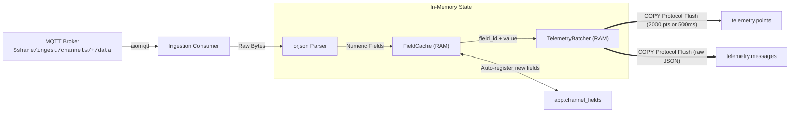

# Ingestion Bridge Service

The **Ingestion Bridge** (`bridge/`) is a dedicated Python microservice designed for low-latency, high-throughput message processing between Eclipse Mosquitto and TimescaleDB.

---

## Core Responsibilities

1. **Shared MQTT Consumer:** Subscribes to `$share/ingest/channels/+/data` to distribute load across worker instances without duplicate ingestion.
2. **Fast JSON Parsing:** Uses `orjson` (written in Rust) to parse JSON payloads up to 10x faster than standard Python `json`.
3. **Dynamic Field Auto-Discovery:** Extracts arbitrary numeric fields without requiring the user to configure columns in advance.
4. **RAM Field ID Caching:** Resolves field names to integer `field_id`s in RAM to prevent database lookups on every packet.
5. **PostgreSQL Binary COPY Batching:** Accumulates parsed points in memory and flushes them into TimescaleDB using binary `COPY` protocol.

---

## Architecture of the Bridge



---

## In-Memory Caching & Guardrails

When a device publishes a new field name (e.g. `"battery_pct"`):

1. `FieldCache` checks its internal dictionary `(channel_id, field_name) -> field_id`.
2. If absent:
   - Verifies the channel has not exceeded `max_fields_per_channel` (default: 500 fields) to protect against malicious key flooding.
   - Inserts the new field into `app.channel_fields` with `ON CONFLICT DO NOTHING`.
   - Caches the resulting `field_id`.

```python
class FieldCache:
    def __init__(self, pool, max_fields_per_channel=500):
        self._cache = {} # (channel_id, name) -> field_id
        self._counts = {} # channel_id -> count
        self._max_fields = max_fields_per_channel
```

---

## PostgreSQL Binary COPY Micro-Batching

Individual `INSERT` statements incur substantial network round-trip overhead. The Bridge uses `asyncpg`'s `copy_records_to_table`:

```python
class TelemetryBatcher:
    def __init__(self, pool, max_batch_size=2000, max_interval=0.5):
        self._points = []
        self._messages = []
        self._max_batch_size = max_batch_size
        self._max_interval = max_interval

    async def flush(self):
        if not self._points and not self._messages:
            return

        async with self._pool.acquire() as conn:
            async with conn.transaction():
                if self._points:
                    await conn.copy_records_to_table(
                        "points",
                        records=self._points,
                        columns=["time", "channel_id", "field_id", "value"],
                        schema_name="telemetry",
                    )
                if self._messages:
                    await conn.copy_records_to_table(
                        "messages",
                        records=self._messages,
                        columns=["time", "channel_id", "device_id", "payload"],
                        schema_name="telemetry",
                    )
```

### Flush Trigger Triggers
The buffer flushes to PostgreSQL whenever:
- The buffer reaches **2,000 points**, OR
- **0.5 seconds** elapses since the last write, whichever occurs first.
